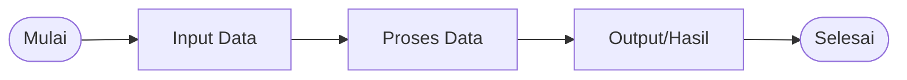
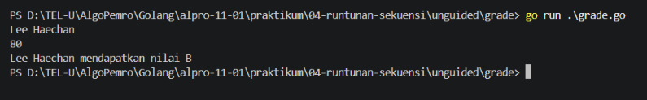
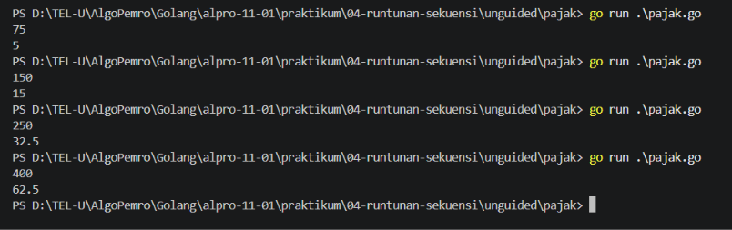

# <h1 align="center">Laporan Praktikum Modul 04 - Runtunan atau Sekuensi</h1>
<p align="center">[Nama Praktikan] - [NIM]</p>

## Dasar Teori

### A. Pengertian Runtunan atau Sekuensi
Runtunan atau Sekuensi adalah struktur algorima paling dasar dalam pemrograman, Proses yang dilakukan secara berurutan dari langkah 1 sampai langkah n atau langkah terakhir. Dimana tiap barisnya hanya dikerjakan satu persatu tanpa ada loncatan atau perulangan.

#### 1. Ciri-ciri Runtunan atau Sekuensi

- Proses yang dilakukan secara berurutan dari langkah 1 sampai langkah n atau langkah terakhir
- Dimana tiap barisnya hanya dikerjakan satu persatu tanpa ada loncatan atau perulangan
- Tidak ada perulangan atau percabangan yang mengubah alur eksekusi program.

#### 2. Masalah yang Dapat Diselesaikan dengan Runtunan atau Sekuensi
- Menyelesaikan masalah yang membutuhkan perhitungan berurutan
- Menampilkan data atau informasi
- Menukar nilai dua variabel
- Melakukan perhitungan matematika

Sekuensi tidak dapat menyelesaikan masalah yang mengambil keputusan atau perulangan.

#### 3. Diagram Alur (Flowchart) Sekuensi



#### 4. Contoh Program Sekuensi

```go
package main

import "fmt"

func main() {
    nama := "Ahmad Fauzan"
    nim := "1301230012"
    jurusan := "S1 Informatika"

    fmt.Println("=== BIODATA MAHASISWA ===")
    fmt.Println("Nama     :", nama)
    fmt.Println("NIM      :", nim)
    fmt.Println("Jurusan  :", jurusan)
}
```

###### Output

```
=== BIODATA MAHASISWA ===
Nama     : Ahmad Fauzan
NIM      : 1301230012
Jurusan  : S1 Informatika
```

## Guided

### 1. grade.go

```go
package main

import (
	"bufio"
	"fmt"
	"os"
)

func main() {
	var nilai float64
	var name string
	var grade string

	scanner := bufio.NewScanner(os.Stdin)

	fmt.Print("Masukan Nama: ")
	scanner.Scan()
	name = scanner.Text()
	fmt.Print("Masukkan nilai siswa: ")
	fmt.Scanln(&nilai)

	if nilai >= 90 && nilai <= 100 {
		grade = "A"
	} else if nilai >= 80 && nilai < 90 {
		grade = "B"
	} else if nilai >= 70 && nilai < 80{
		grade = "C"
	} else if nilai >= 60 && nilai < 70 {
		grade = "D"
	} else {
		grade = "E"
	}

	fmt.Printf("%s mendapatkan nilai %s\n", name, grade)
}
```
#### Deskripsi
Tugas guided ini bertujuan untuk membuat program yang dapat menampilkan nilai atau `grade` siswa berdasarkan skala nilai yang telah ditentukan. Disini kita belajar menggukan package `bufio` untuk membaca inputan user yang memiliki lebih dari 1 kata.

### 2. pilihan.go

```go
package main

import (
	"bufio"
	"fmt"
	"os"
)

func main() {
	var pilihan int
	var nilai float64
	var nama string
	var grade string

	scanner := bufio.NewScanner(os.Stdin)

	fmt.Println("============== Menu ==============")
	fmt.Println("1. Sistem Penilaian")
	fmt.Println("0. Keluar")
	fmt.Print("Masukkan pilihan: ")
	fmt.Scanln(&pilihan)

	if pilihan == 1 {
		fmt.Print("Masukan Nama: ")
		scanner.Scan()
		nama = scanner.Text()
		fmt.Print("Masukkan nilai siswa: ")
		fmt.Scanln(&nilai)

		if nilai >= 90 && nilai <= 100 {
			grade = "A"
		} else if nilai >= 80 && nilai < 90 {
			grade = "B"
		} else if nilai >= 70 && nilai < 80 {
			grade = "C"
		} else if nilai >= 60 && nilai < 70 {
			grade = "D"
		} else {
			grade = "E"
		}

		fmt.Printf("%s mendapatkan nilai %s\n", nama, grade)
	} else if pilihan == 0 {
		fmt.Println("Keluar dari program.")
	} else {
		fmt.Println("Pilihan tidak valid")
	}
}
```
#### Deskripsi
Tugas ini bertujuan untuk membuat program sederhana yang dapat memilih menu berdasarkan inputan user. Dan sekali lagi kita belajar menggunakan package `bufio` untuk membaca inputan user yang memiliki lebih dari 1 kata. Sama juga seperti tugas sebelumnya, program ini juga menampilkan nilai atau `grade` siswa berdasarkan skala nilai yang telah ditentukan, tapi sebelum masuk ke program penilaian, user harus memilih menu terlebih dahulu. Jika user memilih menu 1 maka akan masuk ke program penilaian, jika user memilih menu 0 maka akan keluar dari program, dan jika user memilih menu selain 1 dan 0 maka akan menampilkan pesan "Pilihan tidak valid".

### 3. klasifikasi.go

```go
package main

import "fmt"

func main() {
	var umur, gaji int
	var keterangan string

	fmt.Scanln(&umur)
	fmt.Scanln(&gaji)

	switch {
	case umur < 18:
		keterangan = "Masih sekolah"
	case umur >= 18 && umur <= 25 && gaji >= 50:
		keterangan = "Muda Sukses"
	case umur >= 18 && umur <= 25 && gaji < 50:
		keterangan = "Masih belajar hidup"
	case umur > 25 && umur <= 40 && gaji >= 100:
		keterangan = "Pekerja Mapan"
	case umur > 25 && umur <= 40 && gaji < 100:
		keterangan = "Perlu perbaikan karir"
	case umur > 40 && gaji >= 150:
		keterangan = "Profesional berpengalaman"
	case umur > 40 && gaji < 150:
		keterangan = "Perlu evaluasi karir"
	}

	fmt.Println(keterangan)
}
```
#### Deskripsi
Program ini bertujuan untuk mengklasifikasikan seseorang berdasarkan umur dan gaji yang dimiliki. Kita belajar menggunakan `switch` untuk menentukan keterangan yang sesuai dengan kondisi umur dan gaji yang diberikan oleh user. Berdasarkan input umur dan gaji, program akan mencetak keterangan yang relevan, seperti `Masih sekolah`, `Muda Sukses`, `Pekerja Mapan`, dan lain-lain.

<!-- Tambahkan blok file/kode lain sesuai jumlah file pada soal guided -->

## Unguided

### 1. grade.go

```go
package main

import (
	"bufio"
	"fmt"
	"os"
)

func main() {
	var nilai float64
	var nama string
	var grade string

	scanner := bufio.NewScanner(os.Stdin)

	scanner.Scan()
	nama = scanner.Text()
	fmt.Scanln(&nilai)

	switch {
	case nilai >= 90 && nilai <= 100:
		grade = "A"
	case nilai >= 80 && nilai < 90:
		grade = "B"
	case nilai >= 70 && nilai < 80:
		grade = "C"
	case nilai >= 60 && nilai < 70:
		grade = "D"
	default:
		grade = "E"
	}
	fmt.Printf("%s mendapatkan nilai %s\n", nama, grade)
}
```

##### Output
<!-- Path relatif dari readme.md ke folder unguided/[nama_soal]/output.png, contoh: -->



#### Deskripsi
Sama seperti tugas `grade.go` pada bagian guided, bedanya pada tugas ini kita diharuskan untuk menggunakan `switch` untuk menentukan nilai atau `grade` siswa berdasarkan skala nilai yang telah ditentukan. Disini kita belajar menggunakan package `bufio` untuk membaca inputan user yang memiliki lebih dari 1 kata. `scanner := bufio.NewScanner(os.Stdin)` berfungsi untuk membaca inputan user yang memiliki labih dari 1 kata, disini kita membuat scanner yang siap membaca inputan user. Lalu scanner.Scan() berfungsi untuk membaca inputan user, dan nama = scanner.Text() berfungsi untuk menyimpan nilai inputan user ke dalam variabel nama. Dan kita juga belajar menggunakan `%s` pada `fmt.Printf` untuk menampilkan nilai string dari variabel nama dan grade.

### 2. pajak.go

```go
package main

import "fmt"

func main() {
	var penghasilan, pajak float64

	fmt.Scanln(&penghasilan)

	if penghasilan <= 50 {
		pajak = 0.05 * penghasilan
	} else if penghasilan <= 100 {
		pajak = (0.05 * 50) + (0.10 * (penghasilan - 50))
	} else if penghasilan <= 200 {
		pajak = (0.05 * 50) + (0.10 * 50) + (0.15 * (penghasilan - 100))
	} else {
		pajak = (0.05 * 50) + (0.10 * 50) + (0.15 * 100) + (0.20 * (penghasilan - 200))
	}
	fmt.Println(pajak)
}
```

##### Output


#### Deskripsi
Dalam tugas ini kita mempunyai tugas untuk membuat:
 - Program inputan penghasilan dalam juta dari pengguna
 - Menghitung pajak penghasilan berdasarkan inputan pengguna
 - Menggunakan if-else untuk menentukan pajak yang dikenakan sesuatu kriteria yang telat ditetapkan
 - Menampilan total pajak yang harus dibayar berdasarkan penghasilan yang diberikan.

Ada beberapa kondisi yang ada pada program ini:
 - Jika penghasilan <= 50, maka pajak = 0.05 * penghasilan
 - Jika penghasilan <= 100, maka pajak = (0.05 * 50) + (0.10 * (penghasilan - 50))
 - Jika penghasilan <= 200, maka pajak = (0.05 * 50) + (0.10 * 50) + (0.15 * (penghasilan - 100))
 - Jika penghasilan > 200, maka pajak = (0.05 * 50) + (0.10 * 50) + (0.15 * 100) + (0.20 * (penghasilan - 200))

Kita menggunakan `if-else` untuk pengoperasiannya, dan menyimpan nilai penghasilan dan pajak menggunakan `float64` agar dapat memproses angka desimal.

<!-- Duplikasi blok "### [nama_soal]" sesuai jumlah folder soal di dalam unguided -->


## Kesimpulan
Berdasarkan praktikum ini, kita belajar tentang stuktur dasar pemrograman yaitu Sekuensi, Membaca program secara berurutan dari atas ke bawah, dari langkah 1 ke langkah n tanpa adanya perulangan ataupun percabangan dan hanya di proses satu kali saja. 

## Referensi
1. Modul 04 Runtunan/Sekuensi
2. Cahyo, M. I. D. (2016). Algoritma Runtunan (Sekuensial), Apa Itu? UNIKOM Codelabs, Medium. Diakses pada 13 Oktober 2026 melalui https://medium.com/codelabs-unikom/algoritma-runtunan-apa-itu-936900a84a16
3. Casnadi, E. (t.t.). Struktur Runtunan Algoritma. SlideShare. Diakses pada 13 Oktober 2026 melalui https://www.slideshare.net/slideshow/struktur-runtunan-algoritma/27677788
4. Algoritma Runtunan. (t.t.). Repository Universitas Komputer Indonesia (UNIKOM). Diakses pada 13 Oktober 2026 melalui https://repository.unikom.ac.id/31226/1/Microsoft%20Word%20-%20Bab%2003%20Algoritma%20Runtunan.pdf
5. Runtutan Dasar dalam Pemrograman Pascal: Teori dan Contoh Praktis. (t.t.). Studocu. Diakses pada 13 Oktober 2026 melalui https://www.studocu.id/id/document/universitas-jenderal-soedirman/algoritma-dan-pemrograman/runtutan-dalam-pascal/28922406
<!-- Tambahkan nomor referensi berikutnya sesuai kebutuhan -->
