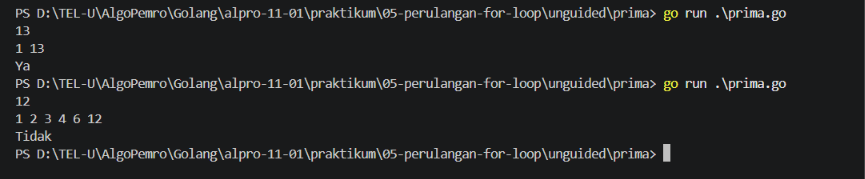
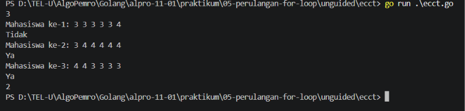

# <h1 align="center">Laporan Praktikum Modul 05 - Perulangan For Loop</h1>
<p align="center">Firas Abdurrahman Sandro - 109092600009</p>

## Dasar Teori

### A. For Loop
Berbeda dari bahasa pemrograman lain yang memiliki berbagai kata kunci untuk melakukan perulangan, seperti `for`, `while`, `while-do`, `reapet-until`, dan sebagainya, Go hanya memiliki satu kata kunci untuk melakukan perulangan, yaitu `for` untuk menangani seluruh bentuk perulangan. 

### B. Empat Bentuk Utama `for loop` dalam Go

#### 1. Bentuk 3 Komponen
Mirip dengan bentuk perulangan `for` pada bahasa pemrograman lain, Go memiliki bentuk perulangan `for` yang terdiri dari tiga komponen yang dipisahkan oleh titik koma (`;`):

- #### Inisialisasi:
    Dijalankan satu kali di awal sebelum iterasi dimulai (biasanya untuk mendeklarasikan variabel counter).
- #### Kondisi:
    Dievaluasi sebelum setiap iterasi. Jika bernilai `true`, perulangan dilanjutkan; jika `false`, perulangan berhenti
- #### Post Statement:
    Dievaluasi di akhir setiap iterasi (biasanya untuk menaikkan/menurunkan nilai counter, misal `i++`).

Contoh:
```go
for i := 1; i <= 5; i++ {
    fmt.Println("Perulangan ke-", i)
}
```

#### 2. `for` sebagai pengganti `while`
Jika inisialisasi dan post statement dihilangkan, perulangan `for` akan berfungsi seperti `while` pada bahasa pemrograman lain. Perulangan akan terus berjalan selama kondisi bernilai `true`. Contoh:
```go
counter := 0
for counter < 5 {
    fmt.Println("Nilai counter:", counter)
    counter++
}
```

#### 3. `for` tanpa kondisi/infinite loop
Jika seluruh komponen dihilangkan, maka perulangan akan berjalan tanpa henti(infinite loop). Perulangan jenis ini biasanya digunakan untuk program server atau listening event, dan wajib dihentikan secara eksplisit dengan `break` atau `return`. Contoh:
```go
i := 1
for {
    if i > 3 {
        break // keluar dari perulangan
    }
    fmt.Println("Iterasi ke-", i)
    i++
}
```

#### 4. `for-range`
Digunakan untuk iterasi atau melintasi elemen di dalam struktur data koleksi seperti arry, slice, string, atau map. Setiap iterasi secara otomatis akan mengembalikan dua nilai: indeks (atau key) dan nilai elemennya (value). Contoh:
```go
buah := []string{"Apel", "Jeruk", "Mangga"}
for index, value := range buah {
    fmt.Println("Index:", index, "- Nilai:", value)
}
```

### C. Nasted For-Loop
Perulangan bersarang adalah strukture perulangan di mana sebuah blok `for` berada di dalam blok `for` lainnya. Setiap kali 1 iterasi pada loop luar berjalan, seluruh proses pada loop dalam akan dieksekusi dari awal hingga selesai. Contoh:
```go
package main

import "fmt"

func main() {
    // Loop luar untuk mengatur baris (1 sampai 3)
    for i := 1; i <= 3; i++ {
        // Loop dalam untuk mengatur kolom/mencetak bintang dalam satu baris
        for j := 1; j <= 3; j++ {
            fmt.Print("* ")
        }
        // Mencetak baris baru setelah loop dalam selesai satu putaran penuh
        fmt.Println()
    }
}
```

Output:
```
* * *
* * *
* * *
```

Penjelasan kode:
- `fmt.Println("* )` mecetak bintang ke samping tanpa berpindah baris.
- `fmt.Println()` di luar loop berfungsi untuk mencetak baris baru setelah perulangan selesai satu putaran penuh.


## 
Catatan :
(`_`) atau Underscore dalam Go, variabel yang sudah dideklarasikan wajib digunakan. Jika hanya membutuhkan nilainya saja tanpa indeks, variabel indeks dapat diganti dengan karakter garis bawah (`_`) agar tidak terjadi error:
```go
for _, value := range buah {
    fmt.Println(value)
}
```

<!-- Tambahkan poin A, B, C, ... atau sub-topik 1, 2, 3, ... sesuai kebutuhan modul -->

## Guided

### 1. tabungan.go

```go
package main

import "fmt"

func main() {
	var a, b, n, total int

	fmt.Scanln(&a)
	fmt.Scanln(&b)
	fmt.Scanln(&n)

	for i := 1; i <=n; i++ {
		total += a
		a += b
	}
	fmt.Println(total)
}
```
#### Deskripsi
Program untuk menghitung total tabungan yang ditabung oleh Budi. Dengan sistem membaca tabung hari pertama `a` dan tabungan hari berikutnya yang menambah sebesar `b`. Misal hari pertama menambung 1000 dan tabungan hari berikutnya menambah 500, maka total tabungan Budi pada hari ke-2 adalah 1500. Program akan menampilkan total tabungan yang telah ditabung oleh Budi.

Program wajib menggunakan perulangan `for`. Input berupa `a` sebagai hari pertama, `b` sebagai tabungan hari berikutnya, dan `n` adalah jumlah hari. Dan output berupa `total` setelah `n` hari.

### 2. terbesar.go

```go
package main

import "fmt"

func main() {
	var n, max, num int

	fmt.Scanln(&n)

	// for i := 1; i <= n; i++ {
	// 	fmt.Scan(&num)
	// 	if i == 1 {
	// 		max = num
	// 	} else {
	// 		if num > max {
	// 			max = num
	// 		}
	// 	}
	// }
	// fmt.Println(max)

	fmt.Scan(&num)
	max = num
	for i := 2; i <= n; i++ {
		fmt.Scan(&num)
		if num > max {
			max = num
		}
	}
	fmt.Println(max)
}
```
#### Deskripsi
Program dengan perulangan `for` untuk mencari bilangan terbesar dari `n` buah bilangan bulat. Program akan membaca `n` yang akan user input sebagai total bilangan yang akan user input nanti(misal input `5` maka user akan melakukan input bilanga sebanyak 5 kali). Lalu user akan melalukan input bilangan sebanyak `n` kali, kemudian program akan menampilkan bilangan terbesar dari `n` bilangan tersebut.

### 3. bioskop.go

```go
package main

import "fmt"

func main() {
	var transaksi, jumlahTiket int
	var hari, jenisFilm string
	var diskon int

	totalPendapatan := 0

	fmt.Scanln(&transaksi)
	for i := 1; i <= transaksi; i++ {
		fmt.Printf("Transaksi ke-%d\n : ", i)
		fmt.Scan(&jenisFilm, &hari, &jumlahTiket)

		hargaSatuan := 0;

		if hari == "Senin" || hari == "Selasa" || hari == "Rabu" || hari == "Kamis" {
			if jenisFilm == "Regular" {
				hargaSatuan = 40000
			} else if jenisFilm == "3D" {
				hargaSatuan = 60000
			} else if jenisFilm == "IMAX" {
				hargaSatuan = 80000
			}
		} else if hari == "Jumat" || hari == "Sabtu" || hari == "Minggu" {
			if jenisFilm == "Regular" {
				hargaSatuan = 50000
			} else if jenisFilm == "3D" {
				hargaSatuan = 70000
			} else if jenisFilm == "IMAX" {
				hargaSatuan = 90000
			}
		}

		totalHarga := hargaSatuan * jumlahTiket

		fmt.Printf("Harga Sebelum Diskon: %d\n", totalHarga)

		if jumlahTiket >= 5 {
			diskon = (totalHarga * 10) / 100
			totalHarga = totalHarga - diskon
		}
		fmt.Printf("Diskon sebesar: %d\n", diskon)
		fmt.Printf("Total Harga : %d\n", totalHarga)


		totalPendapatan += totalHarga
	}

	fmt.Println("Total Pendapatan : ", totalPendapatan)

}
```
#### Deskripsi
Program yang akan menghitung total pendapatan dari beberapa transaksi tiket dalam 1 periode. Program akan membaca sejumlah transaksi lalu setiap transaksi menghitung total harga berdasarkan jenis film, hari, dan jumlah tiket. Jika dalam satu transaksi ada lebih dari atau sama dengan 5 tiket maka akan mendapatkan diskon sebesar 10% dari total harga transaksi tersebut. Terdapat 3 jenis film dengan tarif berbeda tergantung pada hari:
| Jenis Film | Senin - Kamis | Jumat - Minggu |
| :--- | :---: | :---: |
| Regular | 40000 | 50000 |
| 3D | 60000 | 70000 |
| IMAX | 80000 | 90000 |

<!-- Tambahkan blok file/kode lain sesuai jumlah file pada soal guided -->

## Unguided

### 1. prima.go

```go
package main

import "fmt"

func main () {
	var n, count int
	fmt.Scanln(&n)

	for i := 1; i <= n; i++ {
		if n % i == 0 {
			fmt.Printf("%d ", i)
			count++
		}
	}
	fmt.Println()
	
	if count == 2 {
		fmt.Println("Ya")
	} else {
		fmt.Println("Tidak")
	}
}
```

##### Output
<!-- Path relatif dari readme.md ke folder unguided/[nama_soal]/output.png, contoh: -->



#### Deskripsi
Program yang akan menampilkan seluruh bilangan prima dari 1 sampai `n` yang dimasukkan oleh user. Jika `n` adalah bilangan prima maka akan ditampilkan "Ya", jika tidak maka akan ditampilkan "Tidak".

### 2. ecct.go

```go
package main

import "fmt"

func main () {
	var m, p, v, ga,fs, ci, tc, lulus int
	var rataRata float64

	fmt.Scan(&m)

	for i := 1; i <= m; i++ {
		fmt.Printf("Mahasiswa ke-%d: ", i)
		fmt.Scan(&p, &v, &ga, &fs, &ci, &tc)

		if (p < 1 || p > 4) || (v < 1 || v > 4) || (ga < 1 || ga > 4) || (fs < 1 || fs > 4) || (ci < 1 || ci > 4) || (tc < 1 || tc > 4) {
			fmt.Println("Input tidak valid! Harus antara 1 sampai 4.")
			return
		}

		rataRata = float64(p + v + ga + fs + ci + tc) / 6.0

		if rataRata >= 3.33 {
			fmt.Println("Ya")
			lulus++
		} else {
			fmt.Println("Tidak")
		}
	}

	fmt.Println(lulus)
}
```

##### Output


#### Deskripsi
Program yang akan menghitung rata rata nilai ECCT dan menentukan apakah mahasiswa tersebut mendapatkan setifikat atau tidak dengan syarat nilai minimal nilai 3.33. Selain itu program juga menghitung berapa mahasiswa yang mendapatkan sertifikat.

Masukan berupa bilangan bulat `m` yang menyatakan jumlah mahasiswa. Lalu input nilai ECCT dengan total 6 nilai (`p`, `v`, `ga`, `fs`, `ci`, `tc`) untuk setiap mahasiswa, masing masing nilai berkisar antara 1 sampai 4.

Lalu output menyatakan apakah mahasiswa mendapatkan sertifikat atau tidak dan jumlah mahasiswa yang mendapatkan sertifikat.

<!-- Duplikasi blok "### [nama_soal]" sesuai jumlah folder soal di dalam unguided -->


## Kesimpulan
Dalam perulangan bahasa Go hanya memiliki `for` tanpa `while` maupun `while-do` seperti bahasa lain. Pendekatan ini demi menjaga kesederhanaan dan konsistensi bahasa. Meskipun dalam praktiknya, `for` dapat digunakan untuk menangani seluruh bentuk perulangan.

Dengan demikian, meskipun hanya memiliki satu kata kunci, for pada Go mampu menggantikan seluruh jenis perulangan yang ada di bahasa lain. Kuncinya adalah memilih bentuk yang paling sesuai: klasik untuk hitungan pasti, hanya kondisi untuk perulangan berbasis syarat, tanpa kondisi untuk proses yang berjalan terus-menerus, dan `for-range` untuk mengolah koleksi data.

## Referensi
1. Boot.dev. (t.t.). Golang for loop. Boot.dev. Diakses pada 20 Oktober 2026 melalui https://www.boot.dev/blog/golang/golang-for-loop
2. GeeksforGeeks. (t.t.). Loops in Go language. GeeksforGeeks. Diakses pada 20 Oktober 2026 melalui https://www.geeksforgeeks.org/go-language/loops-in-go-language/
3. Laboratorium Informatika. (t.t.). Bahan ajar praktikum: Perulangan for loop dalam bahasa Go (Modul 05 - Algoritma & Pemrograman Go) [Berkas PDF]. Laboratorium Informatika.
4. Medium (@aizarrahima). (t.t.). For loops: Learn Golang. Medium. Diakses pada 20 Oktober 2026 melalui https://medium.com/@aizarrahima/for-loops-learn-golang-2b4e26d1facd
5. Programiz. (t.t.). Go for loop. Programiz. Diakses pada 20 Oktober 2026 melalui https://www.programiz.com/golang/for-loop
6. Ruang Developer. (t.t.). Golang for loop. Ruang Developer Blog. Diakses pada 20 Oktober 2026 melalui https://blog.ruangdeveloper.com/golang-for-loop/
7. SantriKoding. (t.t.). Belajar Golang dasar #7: Control flow (if, switch, loop). SantriKoding. Diakses pada 20 Oktober 2026 melalui https://santrikoding.com/belajar-golang-dasar-7-control-flow-if-switch-loop
8. Telkom University, Fakultas Informatika. (t.t.). Algoritma pemrograman: Bab 3 Perulangan (Looping), Modul 5 Perulangan for loop [Berkas PDF]. Bandung: Telkom University.
9. The Go Authors. (t.t.). A tour of Go: For. Go. Diakses pada 20 Oktober 2026 melalui https://go.dev/tour/flowcontrol/1
10. W3Schools. (t.t.). Go for loops. W3Schools. Diakses pada 20 Oktober 2026 melalui https://www.w3schools.com/go/go_loops.php
11. Wikipedia. (t.t.). Iterasi. Wikipedia Bahasa Indonesia. Diakses pada 20 Oktober 2026 melalui https://id.wikipedia.org/wiki/Iterasi
12. yourbasic.org. (t.t.). For loop. yourbasic.org. Diakses pada 20 Oktober 2026 melalui https://yourbasic.org/golang/for-loop/
<!-- Tambahkan nomor referensi berikutnya sesuai kebutuhan -->
