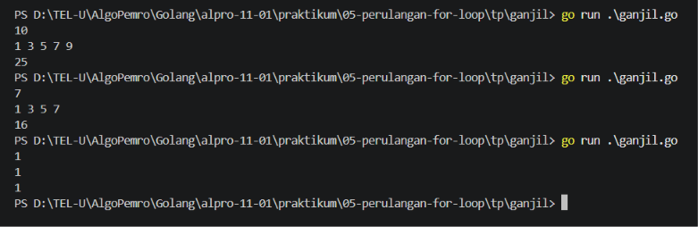
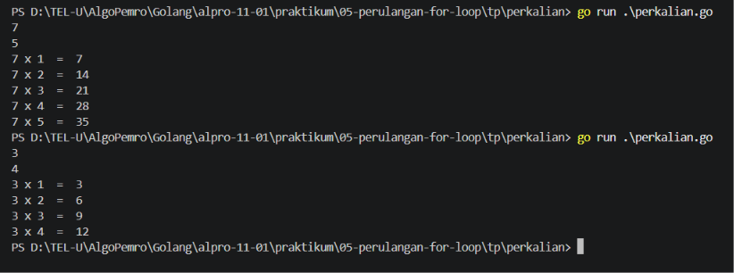

# <h1 align="center">Tugas Pendahuluan Modul 05 - Perulangan For</h1>
<p align="center">[Nama Praktikan] - [NIM]</p>

### 1. Fungsi Utama `for` dalam Go
Fungsi dari perulangan `for` dalam bahasa go untuk menjalankan blok kode secara berulang selama suatu kondisi tertentu terpenuhi. Perulangan ini untuk menghindari penulisan kode yang sama berkali-kali.

Perulangan `for` memiliki tiga komponen sebagai berikut:

```go
for inisialisasi; kondisi; post_statement {
  // kode peruluangan
}
```
 - `inisialisasi` dijalankan satu kali sebelum perulangan, biasanya untuk menentukan nilai awal.
 - `kondisi` dijalankan setiap kali perulangan dilakukan, dan perulangan akan berhenti jika kondisi tidak terpenuhi.
 - `post_statement` dijalankan setiap kali perulangan dilakukan, biasanya untuk mengubah nilai awal.

###### Contoh
```go
package main

import "fmt"

func main() {
    for i := 1; i <= 5; i++ {
        fmt.Println(i)
    }
}
```
###### Output
```go
1
2
3
4
5
```

`i := 1` merupakan inisialisasi, `i <= 5` merupakan kondisi, dan `i++` merupakan post statement. Perulangan ini akan menampilkan angka dari 1 sampai 5.

### 2. Perbedaan `for` dengan tiga komponen dan `for` yang hanya menggunakan kondisi
Bahasa Go tidak memiliki kata kunci `while` dan `do-while`, Tapi kita tetap bisa menggunakan mereka dengan memakai `for` dengan berbagai kondisi, Go menggunakan `for` untuk berbagai jenis perulangan.
#### a. `for` dengan tiga komponen
Seperti perulangan `for` pada umumnya, menggunakan inisialisasi, kondisi, dan post statement. Biasa digunakan ketika mengetahui jumlah perulangan atau wariabel. Contoh:
```go
package main

import "fmt"

func main() {
    for i := 1; i <= 3; i++ {
        fmt.Println(i)
    }
}
```
###### Output
```go
1
2
3
```

#### b. `for` hanya menggunakan kondisi
Hanya menggunakan kondisi tanpa inisialisasi dan post statement di bagian `for`. Bentuknya mirip dengan  perulangan  `while` pada umumnya. Perubahan variabel dilakukan di dalam kondisi. Contoh:
```go
package main

import "fmt"

func main() {
    i := 1

    for i <= 3 {
        fmt.Println(i)
        i++
    }
}
```

###### Output
```go
1
2
3
```

### 3. ganjil.go

```go
package main

import "fmt"

func main() {
	var n, total int

	fmt.Scanln(&n)

	for i := 1; i <= n; i += 2 {
		fmt.Printf("%d ", i)
		total += i
	}

	fmt.Println()
	fmt.Println(total)
}
```
##### Output
<!-- Path relatif dari readme.md ke folder unguided/[nama_soal]/output.png, contoh: -->


#### Deskripsi
Sebuah program perulangan Go menggunakan `for` untuk menampilakan semua bilangan ganjil sampai `n` kemudian dijumlahkan dan ditampilkan di output.

Progra dimulai dari user melakukan input angka `n` untuk menentukan sampai mana program akan menampilkan bilangan ganjil. Lalu program akan mulai menampilakan bilangan dari angka 1 dan menambahkan 2 angka setiap perulangan di bagian `i += 2`, sampai angka yang ditampikan mendekati atau sama dengan angka `n` yang user tampilkan tadi. Di setiap perulangan, setiap angka yang ditampikan akan disimpan dalam variabel `total` dan setiap perulangan, `total` akan dijumlahkan dengan angka yang ditampikan diperulangan tersebut. Setelah perulangan selesai, program akan menampikan hasil dari jumlah `total`.

### 4. perkalian.go

```go
package main

import "fmt"

func main() {
	var a, b int

	fmt.Scan(&a)
	fmt.Scan(&b)

	for i := 1; i <= b; i++ {
		fmt.Println(a, "x", i, " = ", a * i)
	}
}
```
##### Output
<!-- Path relatif dari readme.md ke folder unguided/[nama_soal]/output.png, contoh: -->


#### Deskripsi
Program yang menggunakan perulangan `for` untuk menampilkan tabel perkalian dari bilangan `a` dari `a * 1` sampai `b` (batas perkalian).

Program dimulai dari user melakukan input untuk bilangan `a` (bilangan yang akan dikalikan) dan bilangan `b`(batas perkalian). Lalu program akan menampilkan tabel perkalian dari `a` mulai dari `a * 1` sampai `b` dengan format `a x i = a * i` di setiap perulangan.

## Kesimpulan
`for` merupakan satu satunya perulangan yang dimiliki oleh Go. `for` dengan tiga komponen cocok untuk perulangan yang sudah diketahui varibel dan jumlah perulangannya, sementara itu `for` yang hanya menggunakan kondisi lebih fleksibel karena inisialisasi dan perubahan variabel dapat dilakukan di luar maupun di dalam blok perulangan. 