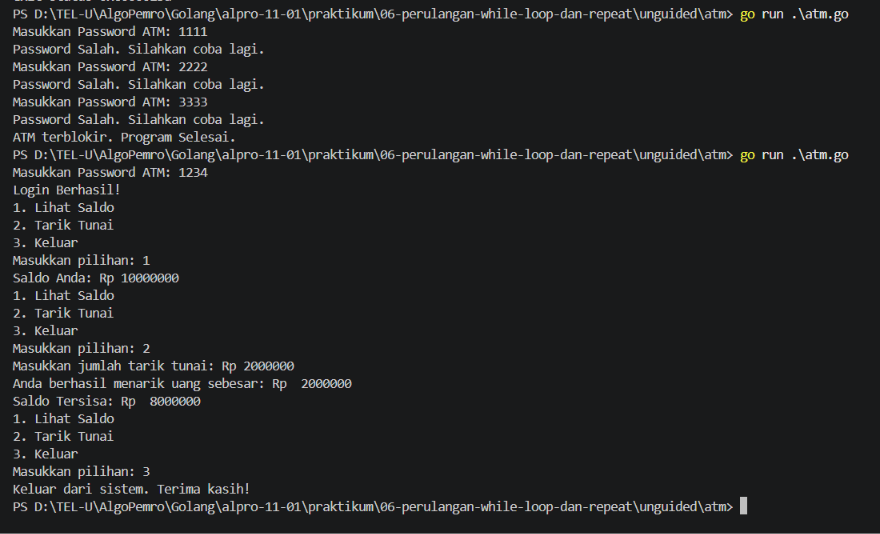

# <h1 align="center">Laporan Praktikum Modul 06 - Perulangan While</h1>
<p align="center">Firas Abdurrahman Sandro - 109092600009</p>

## Dasar Teori

### A. Iterasi Berbasis Kondisi
Berbeda dengan `for-loop` biasa yang jumlah perulangannya sudah pasti, perulangan `while` dan `repeat-until` merupakan iterasi berbasis kondisi. Perulangan ini berhenti ketika kondisi tertentu tidak terpenuhi.

### B. While-Loop (Pengecekan Awal)
Pengecekan kondisi dilakukan di awal sebelum blok kode dimasuki, jika kondisi bernilai `false`, maka blok tidak akan pernah dieksekusi. Dalam bahasa Go tidak memiliki kata kunci `while` khusus. Logika `while` dapat diimplementasikan dengan perulangan `for` dengan kondisi `true` dan perubahan kondisi di dalam blok `for` untuk menghentikan perulangan ketika kondisi bernilai `false`. Contoh:
```go
for kondisi_berjalan {
    // Kode yang diulang terus-menerus selama kondisi bernilai TRUE
}
```

### C. Repeat-Until (Pengecekan Akhir)
Untuk menjalankan kode, minimal harus ada 1 instruksi yang dikerjakan terlebih dahulu, baru kemudian kondisi dicek di akhir. Karena bahasa Go tidak memiliki kata kunci `repeat-until` Logika `repeat-until` dapat diimplementasikan dengan perulangan `for` dengan kondisi `false` dan perubahan kondisi di dalam blok `for` untuk menghentikan perulangan ketika kondisi bernilai `true`. Contoh:
```go
for selesai := false; !selesai; {
    // Blok kode dieksekusi minimal sekali terlebih dahulu

    // Ubah flag menjadi true jika kondisi berhenti tercapai
    selesai = /* kondisi true untuk berhenti */
}
```

### D. Studi Kasus Penerapan Logika While
#### 1. Pola Sentinel
Digunakan ketika perulangan berjalan tanpa batas angka pasti, dan baru akan berhenti jika pengguna memasukkan nilai khusus (sentinel), misalnya mengetikkan string `SELESAI`.
```go
var bunga string
fmt.Scan(&bunga)

for bunga != "SELESAI" {
    fmt.Scan(&bunga) 
}
```

#### 2. Logika Berhenti Ganda
Kodisi lanjut pada perulangan `while` dapat digabungkan menggukan operator logika untuk memenuhi beberapa syarat pembatas sekaligus. Contohnya: perulangan terus berjalan selama selisih beban `< 9` dan total beban `<= 150` dan berat bernilai positif.

## Guided

### 1. terkecil.go

```go
package main

import "fmt"

func main() {
    var batas int
    fmt.Scan(&batas)

    n := 1
    for n*n*n <= batas {
        n++
    }

    fmt.Println(n)
}
```
#### Deskripsi
Program yang menggunakan perulangan `while` untuk mencari bilangan bulat terkecil `n`. Program akan menghitung `n*n*n` sampai lebih besar dari `batas` yang dimasukkan oleh pengguna. Program akan menampilkan bilangan terkecil `n` yang memenuhi syarat tersebut.

### 2. terbesar.go

```go
package main

import "fmt"

func main() {
    var batas int
    fmt.Scan(&batas)

    n := 1
    for n*n < batas {
        n++
    }

    fmt.Println(n - 1)
}
```
#### Deskripsi
Program yang menggunakan perulangan `while` untuk mencari bilangan bulat terbesar `n` sehingga `n*n` lebih kecil dari `batas` yang dimasukkan oleh pengguna. Program akan menaikkan nilai `n` selama `n*n` masih lebih kecil dari `batas`, lalu menampilkan nilai `n - 1` sebagai bilangan terbesar yang memenuhi syarat tersebut.

### 3. vokal.go

```go
package main

import (
    "bufio"
    "fmt"
    "os"
    "strings"
)

func main() {
    reader := bufio.NewReader(os.Stdin)
    kalimat, _ := reader.ReadString('\n')

    i := 0
    jumlahVokal := 0

    for i < len(kalimat) {
        ch := strings.ToLower(string(kalimat[i]))
        if ch == "a" || ch == "i" || ch == "u" || ch == "e" || ch == "o" {
            jumlahVokal++
        }
        i++
    }

    fmt.Println(jumlahVokal)
}
```

#### Deskripsi
Program yang menggunakan perulangan `while` untuk menghitung jumlah huruf vokal (`a`, `i`, `u`, `e`, dan `o`) dalam kata atau kalimat yang dimasukkan oleh pengguna. Program memeriksa setiap karakter tanpa membedakan huruf kecil dan huruf kapital, lalu menampilkan jumlah huruf vokal yang ditemukan.

<!-- Tambahkan blok file/kode lain sesuai jumlah file pada soal guided -->

## Unguided

### 1. atm.go

```go
package main

import "fmt"

func main() {
	var saldo int =  10000000
	var login bool = false
	var pass, i int

	for i != 3 && login == false {
		fmt.Print("Masukkan Password ATM: ")
		fmt.Scan(&pass)

		if pass == 1234 {
			login = true
		} else {
			fmt.Println("Password Salah. Silahkan coba lagi.")
			i++
		}
	}

	if login == false {
		fmt.Println("ATM terblokir. Program Selesai.")
		return
	}

	fmt.Println("Login Berhasil!")
	
	pilihan := 0
	for pilihan != 3 {
		fmt.Println("1. Lihat Saldo")
		fmt.Println("2. Tarik Tunai")
		fmt.Println("3. Keluar")
		fmt.Print("Masukkan pilihan: ")
		fmt.Scan(&pilihan)

		if pilihan == 1 {
			fmt.Printf("Saldo Anda: Rp %d\n", saldo)
		} else if pilihan == 2 {
			var tarik int
			fmt.Print("Masukkan jumlah tarik tunai: Rp ")
			fmt.Scan(&tarik)
			if tarik > saldo {
				fmt.Println("Saldo tidak cukup.")
			} else {
				fmt.Println("Anda berhasil menarik uang sebesar: Rp ", tarik)
				saldo -= tarik
				fmt.Println("Saldo Tersisa: Rp ", saldo)
			}
		} else if pilihan == 3 {
			fmt.Println("Keluar dari sistem. Terima kasih!")
		}
	}

}
```

##### Output
<!-- Path relatif dari readme.md ke folder unguided/[nama_soal]/output.png, contoh: -->



#### Deskripsi
Program yang menggunakan perulangan `while` untuk menyimulasikan sistem ATM. Program meminta pengguna memasukkan password `1234` dengan maksimal tiga kali percobaan, lalu menampilkan menu ATM jika login berhasil. Pengguna dapat melihat saldo awal sebesar Rp 10.000.000, menarik uang selama saldo mencukupi, atau keluar dari program. Jika password salah sebanyak tiga kali, ATM akan terblokir dan program berakhir.

<!-- Duplikasi blok "### [nama_soal]" sesuai jumlah folder soal di dalam unguided -->


## Kesimpulan
Bahasa Go tidak memiliki kata kunci `while` dan `repeat-until` secara khusus, tetapi kedua bentuk perulangan tersebut dapat dibuat menggunakan `for` dengan kondisi yang sesuai. Perulangan `while` memeriksa kondisi sebelum menjalankan instruksi, sedangkan pola `repeat-until` menjalankan instruksi terlebih dahulu sebelum memeriksa kondisi berhenti. Dengan memahami kedua pola ini, program dapat mengulang instruksi sesuai kebutuhan dan berhenti ketika kondisi yang ditentukan tercapai, seperti pada program pencarian bilangan, penghitungan huruf vokal, dan simulasi ATM.

## Referensi
1. Fika Ridaul Maulayya. (2026). Belajar Golang Dasar #7: Control Flow (if, switch, loop). Jombang: SantriKoding. Diakses pada 27 Oktober 2026 melalui https://santrikoding.com/belajar-golang-dasar-7-control-flow-if-switch-loop.
2. Badan Pengembangan dan Pembinaan Bahasa. (2026). Iterasi. Jakarta: Wikipedia bahasa Indonesia. Diakses pada 27 Oktober 2026 melalui https://id.wikipedia.org/wiki/Iterasi.
3. Rizky Kurniawan. (2022). #18: For Loop - Belajar Golang Dari Dasar. Bandung: Ruang Developer. Diakses pada 27 Oktober 2026 melalui https://blog.ruangdeveloper.com/golang-for-loop/.
4. Refsnes Data. (2026). Go For Loops. Refsnes: W3Schools. Diakses pada 27 Oktober 2026 melalui https://www.w3schools.com/go/go_loops.php.
5. Laboratorium Praktikum Informatika Universitas Telkom. (2026). Modul 05 - Algoritma & Pemrograman (Go): Perulangan for Loop dalam Bahasa Go. Bandung: Fakultas Informatika Universitas Telkom.
6. Laboratorium Praktikum Informatika Universitas Telkom. (2026). Modul 6: Logika While & Repeat-Until. Bandung: Fakultas Informatika Universitas Telkom.
7. Parewa Labs Pvt. Ltd. (2026). Programming Go for-loop. Parewa: Programiz. Diakses pada 27 Oktober 2026 melalui https://www.programiz.com/golang/for-loop.
<!-- Tambahkan nomor referensi berikutnya sesuai kebutuhan -->
