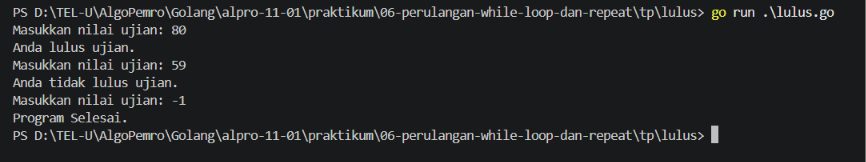
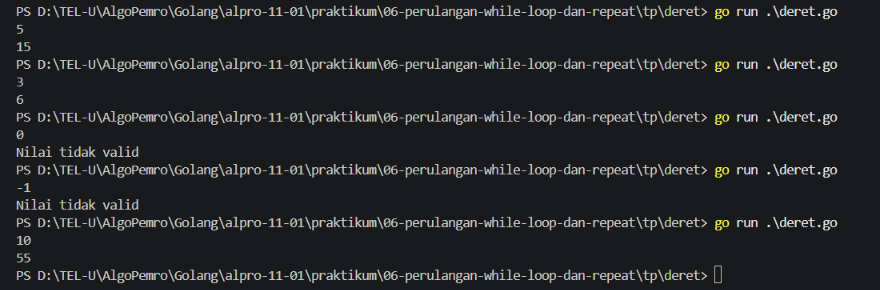
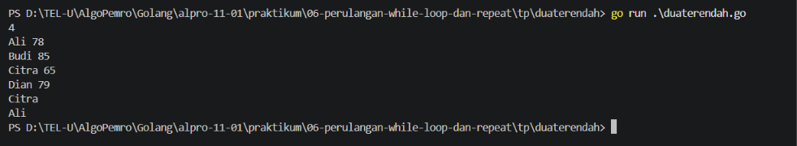
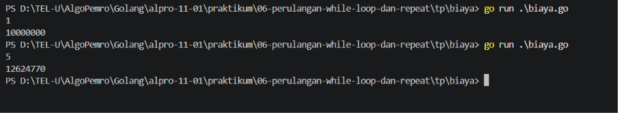

# <h1 align="center">Tugas Pendahuluan Modul 06 - Perulangan While</h1>
<p align="center">[Nama Praktikan] - [NIM]</p>

### 1. lulus.go

```go
package main

import "fmt"

func main() {
	var nilai int

	for {
		fmt.Print("Masukkan nilai ujian: ")
		fmt.Scan(&nilai)

		if nilai == -1 {
			break
		}
		
		if nilai >= 60 {
			fmt.Println("Anda lulus ujian.")
		} else if nilai < 60 {
			fmt.Println("Anda tidak lulus ujian.")
		}
	}
	fmt.Println("Program Selesai.")
}
```

##### Output
<!-- Path relatif dari readme.md ke folder unguided/[nama_soal]/output.png, contoh: -->



#### Deskripsi
Program berulang yang meminta user untuk memasukan nilai ujian mereka, Jika nilai lebih besar atau sama dengan 60, maka dinyatakan lulus, tapi jika nilai dibawah 60, maka dinyatakan tidak lulus. Program akan terus berulang hingga user memasukan -1 untuk menutup program.

Program masuk keperulangan dan menampilkan pesan `Masukan nilai ujian: `, user diminta untuk input nilai ujian. Jika nilai lebih besar sama sama dengan 60, program akan menampilan pesan `Anda lulus ujian.`, tapi jika nilai dibawah 60, program akan menampilkan pesan `Anda tidak lulus ujian.`. Program akan terus berulang hingga user melakukan input -1 untuk menutup program.

### 2. deret.go

```go
package main

import "fmt"

func main() {
	var n, total int

	fmt.Scanln(&n)

	if n < 1 {
		fmt.Println("Nilai tidak valid")
		return
	}
	for i := 1; i <= n; i++ {
		total += i
	}
	fmt.Println(total)
}
```

##### Output
<!-- Path relatif dari readme.md ke folder unguided/[nama_soal]/output.png, contoh: -->



#### Deskripsi
Program yang menghitung jumlah dari deret angka 1 sampai `n` menggunakan `while`.

User memasukan nilai `n` sebagai jumlah deret yang akan dihitung. Lalu program akan menghitung dari angka 1 sampai `n` dan menampilkan jumlah dari deret tersebut.

### 3. duaterandah.go

```go
package main

import "fmt"

func main() {
	var n, nilai, nilai1 int
	var nama, nama1 string

	i := 2

	fmt.Scan(&n)

	fmt.Scan(&nama1, &nilai1)

	min1Nilai := nilai1
	min1Nama := nama1

	min2Nilai := 9999999
	min2Nama := ""

	for i <= n {
		fmt.Scan(&nama, &nilai)

		if nilai < min1Nilai {
			min2Nilai = min1Nilai
			min2Nama = min1Nama
			min1Nilai = nilai
			min1Nama = nama
		} else if nilai < min2Nilai && nilai != min1Nilai {
			min2Nilai = nilai
			min2Nama = nama
		}
		i++
	}
	fmt.Println(min1Nama)
	fmt.Println(min2Nama)
}
```

##### Output
<!-- Path relatif dari readme.md ke folder unguided/[nama_soal]/output.png, contoh: -->



#### Deskripsi

Program yang menentukan nama peserta dengan nilai terendah dan nilai terendah kedua dari sejumlah peserta.

User memasukan jumlah peserta `n`, lalu memasukan nama dan nilai setiap peserta. Program akan membandingkan nilai yang dimasukan untuk mencari dua nilai terendah yang berbeda, kemudian menampilkan nama peserta dengan nilai terendah dan nilai terendah kedua.

### 4. biaya.go

```go
package main

import "fmt"

func main () {
	var n int
	var ukt float64 = 10000000

	fmt.Scanln(&n)

	for i := 2; i <= n; i++ {
		ukt *= 1.06
	}

	fmt.Printf("%0.f", ukt)
}
```

##### Output
<!-- Path relatif dari readme.md ke folder unguided/[nama_soal]/output.png, contoh: -->



#### Deskripsi
Program yang akan menghitung total biaya kuliah pada tahun ke-`n`. Dengan biaya kuliah sebesar 10000000 di bulan pertama dan bertambah sebesar 6% tiap tahunnya. 

User akan menginput tahun ke-`n` dan program akan menghitung total biaya dari 10000000 di kali 6% sebanyak `n` kali. Program akan menampilkan total biaya kuliah pada tahun ke-`n`.


## Kesimpulan
Pada tugas pendahuluan ini, perulangan `for` di Go dapat digunakan seperti `while` untuk mengulang proses selama kondisi terpenuhi. Perulangan tersebut membantu menyelesaikan berbagai masalah, seperti memeriksa kelulusan, menjumlahkan deret, mencari dua nilai terendah, dan menghitung kenaikan biaya kuliah.