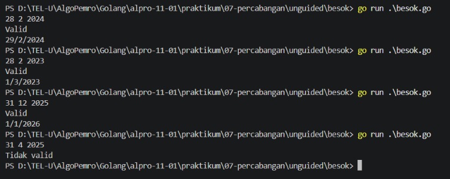
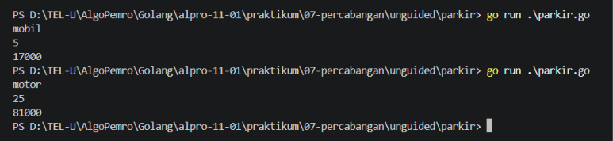

# <h1 align="center">Laporan Praktikum Modul 7 - Percabangan</h1>
<p align="center">[Nama Praktikan] - [NIM]</p>

## Dasar Teori

### A. Percabangan `if`, `else-if` dan `else`
Percabangan adalah struktur kontrol alur yang memungkinkan program untuk mengambil keputusan dan mengeksekusi blok kode tertentu berdasarkan kondisi boolean. Dalam bahasa Go, secara umum terdapat dua jenis struktur percabangan utama, yaitu `if` statement dan `switch`.

Struktur `if` digunakan untuk memeriksa suatu kondisi, jika kondisi bernilai `true`. maka blok kode di dalamnya akan dieksekusi.

#### 1. Aturan Penulisan
- Berbeda dengan bahasa seperti C, C++, atau Java, kondisi pada percabangan di Go tidak memerlukan tanda kurung di sekitarnya.
- Penggunaan tanda kurung kurawal `{}` untuk membungkus blok kode adalah wajib, meskipun blok kode tersebut hanya berisi satu baris.

#### 2. Contoh Implementasi
```go
package main

import "fmt"

func main() {
    nilai := 85

    if nilai >= 90 {
        fmt.Println("Predikat: A")
    } else if nilai >= 80 {
        fmt.Println("Predikat: B")
    } else {
        fmt.Println("Predikat: C atau di bawahnya")
    }
}
```

#### 3. `if` dengan Short Statement
Go memungkinkan mendeklarasi dan menginisialisasi sebuah variabel di dalam blok `if` sebelum pengecekan kondisi dilakukan. Variabel tersebut hanya dapat diakses di dalam blok `if-else` tersebut.

```go
package main

import "fmt"

func main() {
    // 'score := 75' adalah short statement
    if score := 75; score >= 70 {
        fmt.Println("Lulus dengan baik")
    } else {
        fmt.Println("Remedial")
    }
}
```

### B. Percabangan `switch`
Struktur `switch` digunakan sebagai alternatif yang lebih rapih dan mudah dibaca ketika kita harus mengecek satu variabel terhadap banyak pilihan nilai.

#### 1. Karakteristik `switch` Golang
- Di bahasa Go, kita tidak perlu menuliskan `break` di akhir setiap `case`. Begitu sebuah case terpenuhi, program akan langsung keluar dari blok `switch` secara otomatis.
- Kita dapat menggabungkan beberapa nilai dalam satu `case` dengan memisahkannya menggunakan tanda koma (`,`).

#### 2. Contoh
```go
package main

import "fmt"

func main() {
    hari := "Senin"

    switch hari {
    case "Senin":
        fmt.Println("Hari kerja awal pekan")
    case "Sabtu", "Minggu":
        fmt.Println("Hari libur (Weekend)")
    default:
        fmt.Println("Hari kerja biasa")
    }
}
```

<!-- Tambahkan poin A, B, C, ... atau sub-topik 1, 2, 3, ... sesuai kebutuhan modul -->

## Guided

### 1. kabisat.go

```go
package main

import "fmt"

func main() {
	var tahun int

	fmt.Print("Cek tahun: ")
	fmt.Scan(&tahun)

	if tahun % 4 == 0 || tahun % 400 == 0 && tahun % 100 != 0 {
		fmt.Println("Tahun kabisat")
	} else {
		fmt.Println("Bukan tahun kabisat")
	}
}
```
#### Deskripsi
Program `kabisat.go` digunakan untuk menentukan apakah suatu tahun merupakan tahun kabisat atau bukan. Pengguna memasukkan sebuah bilangan bulat yang menyatakan tahun melalui fungsi `fmt.Scan()`. Program kemudian memeriksa tahun tersebut menggunakan struktur percabangan `if-else` berdasarkan ketentuan tahun kabisat, yaitu habis dibagi 4 dan tidak habis dibagi 100, atau habis dibagi 400. Hasil pengecekan akan ditampilkan dengan teks `Tahun kabisat` atau `Bukan tahun kabisat` melalui fungsi `fmt.Println()`.

### 2. segitiga.go

```go
package main

import "fmt"

func main() {
	var a, b, c int

	fmt.Scan(&a, &b, &c)

	if a <= 0 || b <= 0 || c <= 0 || a+b <= c || b+c <= a || c+a <= b {
		fmt.Println("Bukan segitiga")
	} else if a == b && b == c {
		fmt.Println("Segitiga sama sisi")
	} else if a == b || b == c || c == a {
		fmt.Println("Segitiga sama kaki")
	} else {
		fmt.Println("Segitiga sembarang")
	}	
}
```
#### Deskripsi
Program `segitiga.go` digunakan untuk menerima tiga buah bilangan bulat yang menyatakan panjang sisi segitiga, yaitu `a`, `b`, dan `c` melalui fungsi `fmt.Scan()`. Program kemudian menentukan jenis segitiga dengan menggunakan struktur percabangan `if-else`. Pertama, program memeriksa apakah ketiga sisi memenuhi syarat segitiga atau menghasilkan `Bukan segitiga`. Jika memenuhi syarat, ketiga sisi yang sama panjang akan menghasilkan `Segitiga sama sisi`, tepat dua sisi yang sama panjang akan menghasilkan `Segitiga sama kaki`, sedangkan ketiga sisi yang berbeda panjang akan menghasilkan `Segitiga sembarang`.

### 3. kalkulator.go

```go
package main

import "fmt"

func main() {
	var a, b int
	var op string

	fmt.Scan(&a, &op, &b)

	switch op {
	case "+":
		fmt.Println(a + b)
	case "-":
		fmt.Println(a - b)
	case "*":
		fmt.Println(a * b)
	case "/":
		if b == 0 {
			fmt.Println("Error: pembagian dengan nol")
			return
		}
		fmt.Printf("%.2f\n", float64(a)/float64(b))
	case "%":
		if b == 0 {
			fmt.Println("Error: pembagian dengan nol")
			return
		}
		fmt.Println(a % b)
	default:
		fmt.Println("Operator tidak valid")
	}
}
```

#### Deskripsi
Program `kalkulator.go` digunakan untuk melakukan operasi hitung sederhana berdasarkan dua bilangan bulat dan sebuah operator yang dimasukkan pengguna melalui fungsi `fmt.Scan()`. Program menggunakan struktur percabangan `switch` untuk memilih operasi sesuai operator yang diberikan, seperti penjumlahan dengan `+`, pengurangan dengan `-`, perkalian dengan `*`, pembagian dengan `/`, dan sisa hasil bagi dengan `%`. Jika operator pembagian atau sisa hasil bagi digunakan dengan bilangan kedua bernilai nol, program akan menampilkan pesan kesalahan. Selain itu, jika operator yang dimasukkan tidak terdapat pada daftar operasi, program akan menampilkan pesan `Operator tidak valid`.

### 4. ongkir.go

```go
package main

import (
	"fmt"
	"math"
)

func main() {
	var berat float64
	var layanan string
	var tarif, zona int

	fmt.Print("Masukkan Berat (kg): ")
	fmt.Scan(&berat)
	fmt.Print("Masukkan Zona (1/2/3): ")
	fmt.Scan(&zona)
	fmt.Print("Masukkan Layanan (Regular/Express): ")
	fmt.Scan(&layanan)

	hasilBulat := math.Ceil(berat)
	berat = hasilBulat

	if berat >= 30 {
		fmt.Println("-")
		return
	}

	switch zona {
	case 1:
		tarif = 10000
		tarif *= int(berat)
		if layanan == "Express" {
			tarif += tarif / 2
		}
	case 2:
		tarif = 15000
		tarif *= int(berat)
		if layanan == "Express" {
			tarif += tarif / 2
		}
	case 3:
		tarif = 25000
		tarif *= int(berat)
		if layanan == "Express" {
			tarif += tarif / 2
		}
	default:
		fmt.Println("Zona tidak valid")
		return
	}

	fmt.Printf("%.0f\n%d", berat, tarif)
}
```

#### Deskripsi
Program `ongkir.go` digunakan untuk menghitung biaya pengiriman paket berdasarkan zona tujuan, berat paket, dan jenis layanan yang dipilih pengguna. Pengguna memasukkan zona, berat paket dalam kilogram, dan jenis layanan melalui fungsi `fmt.Scan()`. Program memeriksa berat paket yang tidak boleh melebihi 30 kg serta zona yang hanya menerima nilai 1, 2, atau 3, lalu menggunakan struktur percabangan `switch` untuk menentukan tarif dasar berdasarkan zona tujuan. Berat paket dibulatkan ke atas setiap 2,3 kg menjadi kelipatan 3 kg, kemudian total ongkos dihitung berdasarkan tarif dasar dikalikan berat bulat dan ditambah biaya 50% apabila layanan Express dipilih.

<!-- Tambahkan blok file/kode lain sesuai jumlah file pada soal guided -->

## Unguided

### 1. besok.go

```go
package main

import "fmt"

func main() {
	var tanggal, bulan, tahun int
	fmt.Scan(&tanggal, &bulan, &tahun)

	if bulan < 1 || bulan > 12 {
		fmt.Println("Bulan tidak valid")
		return
	}

	maxHari := 31
	switch bulan {
	case 4, 6, 9, 11:
		maxHari = 30
	case 2:
		kabisat := tahun % 4 == 0 || (tahun % 400 == 0 && tahun % 100 != 0)
		if kabisat {
			maxHari = 29
		} else {
			maxHari = 28
		}
	}

	if tanggal < 1 || tanggal > maxHari {
		fmt.Println("Tidak valid")
		return
	}

	fmt.Println("Valid")

	besokTanggal := tanggal + 1
	besokBulan := bulan
	besokTahun := tahun

	if besokTanggal > maxHari {
		besokTanggal = 1
		besokBulan++
		if besokBulan > 12 {
			besokBulan = 1
			besokTahun++
		}
	}

	fmt.Printf("%d/%d/%d", besokTanggal, besokBulan, besokTahun)
}
```

##### Output
<!-- Path relatif dari readme.md ke folder unguided/[nama_soal]/output.png, contoh: -->



#### Deskripsi
Program `besok.go` digunakan untuk memvalidasi sebuah tanggal yang terdiri atas tanggal, bulan, dan tahun, kemudian menentukan tanggal pada hari berikutnya. Pengguna memasukkan ketiga nilai tersebut melalui fungsi `fmt.Scan()`. Program pertama-tama memeriksa apakah bulan berada pada rentang 1 hingga 12, lalu menentukan jumlah hari maksimum pada bulan tersebut menggunakan struktur percabangan `switch`. Untuk bulan Februari, program memeriksa tahun kabisat agar menentukan jumlah hari sebesar 29 atau 28 hari. Jika tanggal tidak valid, program akan menampilkan `Tidak valid`; sedangkan jika valid, program akan menampilkan `Valid` dan menghitung pergantian hari berikutnya, termasuk pergantian bulan dan pergantian tahun.

### 2. parkir.go

```go
package main

import "fmt"

func main() {
	var kendaraan string
	var waktu, tarif int

	fmt.Scanln(&kendaraan)
	fmt.Scanln(&waktu)

	tarifMobil := 5000
	tarifMotor := 3000

	if kendaraan == "mobil" {
		if waktu > 1 {
			tarif = tarifMobil + (3000 * (waktu - 1))
		} else {
			tarif = tarifMobil
		}
	} else if kendaraan == "motor" {
		if waktu > 1 {
			tarif = tarifMotor + (2000 * (waktu - 1))
		} else {
			tarif = tarifMotor
		}
	}

	if waktu > 24 {
		if kendaraan == "mobil" {
			tarif += 50000
		} else if kendaraan == "motor" {
			tarif += 30000
		}
	}

	fmt.Println(tarif)
}
```

##### Output


#### Deskripsi
Program `parkir.go` digunakan untuk menghitung tarif parkir berdasarkan jenis kendaraan dan lama waktu parkir. Pengguna memasukkan jenis kendaraan berupa `mobil` atau `motor`, serta lama parkir dalam satuan jam melalui fungsi `fmt.Scanln()`. Program menggunakan struktur percabangan `if-else` untuk menentukan tarif berdasarkan ketentuan soal, yaitu tarif mobil Rp5.000 untuk jam pertama dan Rp3.000 untuk setiap jam berikutnya, sedangkan tarif motor Rp3.000 untuk jam pertama dan Rp2.000 untuk setiap jam berikutnya. Jika lama parkir lebih dari 24 jam, program menambahkan denda Rp50.000 untuk mobil atau Rp30.000 untuk motor. Hasil perhitungan tarif akhir kemudian ditampilkan melalui fungsi `fmt.Println()`.

<!-- Duplikasi blok "### [nama_soal]" sesuai jumlah folder soal di dalam unguided -->


## Kesimpulan
Percabangan dalam Bahasa Go dirancang secara bersih dan efisien melalui struktur `if` dan `switch`. Penggunaan syntax yang ringkas (seperti peniadaan tanda kurung pada kondisi dan otomatisasi `break` pada `switch`) membuat kode lebih mudah dibaca, dikelola, serta meminimalkan kesalahan penulisan logika bagi pengembang.

## Referensi
1. Fika Ridaul Maulayya. (2026). Belajar Golang Dasar #7: Control Flow (if, switch, loop). Jombang: SantriKoding. Diakses pada 30 Oktober 2026 melalui https://santrikoding.com/belajar-golang-dasar-7-control-flow-if-switch-loop
2. Rizky Kurniawan. (2022). #18: For Loop - Belajar Golang Dari Dasar. Bandung: Ruang Developer. Diakses pada 30 Oktober 2026 melalui https://blog.ruangdeveloper.com/golang-for-loop/
3. Refsnes Data. (2026). Go For Loops. Refsnes: W3Schools. Diakses pada 30 Oktober 2026 melalui https://www.w3schools.com/go/go_loops.php
4. Parewa Labs Pvt. Ltd. (2026). Programming Go for-loop. Parewa: Programiz. Diakses pada 30 Oktober 2026 melalui https://www.programiz.com/golang/for-loop
5. Laboratorium Praktikum Informatika Universitas Telkom. (2026). JURNAL MODUL 07 - Percabangan - Golang. Bandung: Fakultas Informatika Universitas Telkom.
<!-- Tambahkan nomor referensi berikutnya sesuai kebutuhan -->
