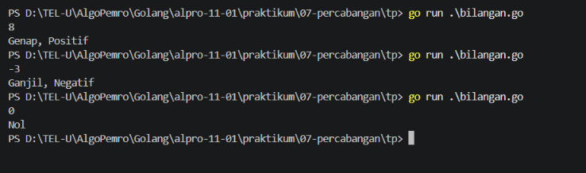
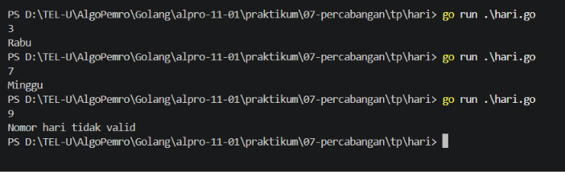
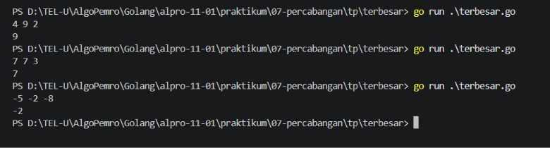

# <h1 align="center">Tugas Pendahuluan Modul 7 - Percabangan</h1>
<p align="center">[Nama Praktikan] - [NIM]</p>

### 1. Perbedaan `if`, `if-else`, `else if`, dan `switch` pada Go dan 2 perbedaan `switch` pada Go dibandingkan dengan Java
`if` digunakan untuk mengecek satu kondisi boolean tunggal, sedangkan `if-else` menyediakan dua jalur eksekusi berdasarkan kondisi benar atau salah. `else if` digunakan untuk mengecek banyak kondisi secara berurutan sedangan `switch` sebagai alternatif yang lebih bersih dan mudah dibaca dari `else if` untuk mencocokan nilai dari sebuah ekspresi dengan berbagai pilihan alternatif.

Selain itu terdapat dua perbedaan pada `switch` di Go dan di Java. Pertama `switch` di Go secara default memiliki fitur implicit break sehingga tidak memerlukan perintah `break` di akhir setiap `case`, sedangan Java mewajibkan menggunakan `break`agar eksekusi tidak tembus. Kedua `switch` di Go dapat digunakan tanpa ekspresi variabel untuk bertindak sebagai pengganti rangkai `if-else`, sedangkan Java mewajibkan adanya ekspresi atau variable yang dievalusi pada pernyataan `switch`. 

### 2. bilangan.go

```go
package main

import "fmt"

func main() {
	var bil int

	fmt.Scanln(&bil)

	if bil == 0 {
		fmt.Println("Nol")
		return
	}else if bil % 2 == 0 {
		fmt.Print("Genap, ")
	} else {
		fmt.Print("Ganjil, ")
	}

	if bil > 0 {
		fmt.Println("Positif")
	} else if bil < 0 {
		fmt.Println("Negatif")
	} 
}
```

##### Output
<!-- Path relatif dari readme.md ke folder unguided/[nama_soal]/output.png, contoh: -->



#### Deskripsi
Program Go menggukan percabangan untuk mencek inputan user apakah bilangan tersebut genap, ganjil, positif, negatif, atau nol. Dengan pengcekan pertama dilakukan pengecekan untuk bilangan nol lalu melakukan `return` untuk mengakhiri program, kemudian dilakukan pengecekan untuk bilangan genap dan ganjil jika bilangan bukan nol. Setelah itu dilakukan pengecekan untuk bilangan positif dan negatif.

### 3. hari.go

```go
package main

import "fmt"

func main() {
	var hari int

	fmt.Scanln(&hari)

	switch hari {
	case 1:
		fmt.Println("Senin")
	case 2:
		fmt.Println("Selasa")
	case 3:
		fmt.Println("Rabu")
	case 4:
		fmt.Println("Kamis")
	case 5:
		fmt.Println("Jumat")
	case 6:
		fmt.Println("Sabtu")
	case 7:
		fmt.Println("Minggu")
	default:
		fmt.Println("Nomor hari tidak valid")
	}
}
```

##### Output


#### Deskripsi
Program Go menggunakan percabangan `switch` untuk mengecek nomor hari yang dimasukkan oleh user. Jika input bernilai 1 sampai 7, program menampilkan nama hari yang sesuai, mulai dari Senin hingga Minggu. Jika nomor yang dimasukkan berada di luar rentang tersebut, program menampilkan pesan bahwa nomor hari tidak valid.

### 4. terbesar.go

```go
package main

import "fmt"

func main() {
	var a, b, c, terbesar int

	fmt.Scan(&a, &b, &c)

	if a >= b && a >= c {
		terbesar = a
	} else if b >= a && b >= c {
		terbesar = b
	} else {
		terbesar = c
	}

	fmt.Println(terbesar)
}
```

##### Output


#### Deskripsi
Program Go menggunakan percabangan `if-else` untuk membandingkan tiga bilangan bulat yang dimasukkan oleh user. Program mengecek bilangan mana yang nilainya paling besar, termasuk jika ada dua bilangan dengan nilai tertinggi yang sama, lalu menampilkan bilangan terbesar tersebut.

## Kesimpulan
Percabangan dalam bahasa Go dapat digunakan untuk menentukan instruksi yang dijalankan berdasarkan kondisi atau nilai masukan. Percabangan `if`, `else if`, dan `else` dapat digunakan untuk memeriksa beberapa kondisi, sedangkan `switch` memudahkan pemilihan hasil berdasarkan nilai tertentu. Pada program yang dibuat, percabangan digunakan untuk menentukan jenis bilangan, nama hari, dan bilangan terbesar dari tiga masukan.